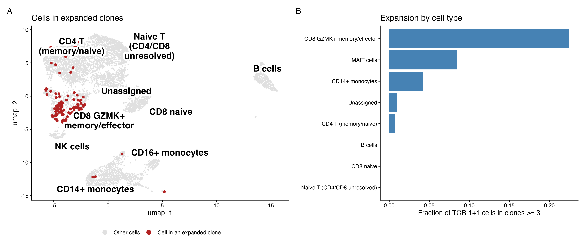

# T-cell clonal expansion in a healthy donor (10x 5' GEX + V(D)J, PBMC)

Small exploratory re-analysis of a public 10x Genomics dataset, written to practise paired
single-cell RNA + TCR analysis in R/Seurat. It is **not** a new finding: one donor, descriptive only.

## Question
In a healthy donor, which T-cell states carry expanded TCR clones (identical CDR3α + CDR3β in ≥3 cells)?
Expectation, fixed before looking at the clone counts: expansions sit in CD8 memory/effector cells, not in naive T cells.
(The memory/effector group was first defined as two clusters; one of them later turned out to be MAIT cells, see below.
Both definitions are reported.)

## Data
- 10x Genomics, **"10k Human PBMCs, 5' v2.0, Chromium X (without intronic reads)"**, CC BY 4.0
  ([dataset page](https://www.10xgenomics.com/jp/datasets/10k-human-pbmcs-5-v2-0-chromium-x-without-intronic-reads-2-standard)).
- Healthy donor (PBMC from AllCells), 5' gene expression + V(D)J T from the same cells, Cell Ranger 6.1.2 (`cellranger multi`).
- Files used (not redistributed, download them into `data/`):
  `..._count_sample_feature_bc_matrix.h5` and `..._vdj_t_filtered_contig_annotations.csv`
  (exact file names in the config block of the script).

## Run
```r
source("pbmc_tcr_clonal_expansion.R")   # Seurat v5, hdf5r, dplyr, ggplot2 (+ ggrepel, patchwork, scales, installed with Seurat)
```
Optional (recommended): `BiocManager::install("scDblFinder")` for doublet flagging; the script skips this step if the package is missing.

Outputs: `results/figures/` (PNG, 300 dpi), `results/tables/` (CSV tables, labelled Seurat object, `sessionInfo.txt`). Seed 42.
Tested with R 4.5.2 and Seurat 6.0.0 (v5 API); exact versions in `results/tables/sessionInfo.txt`.

## Methods in brief
- **QC**: 500 < genes < 4000 per cell, mitochondrial reads < 15%. Thresholds were chosen from violin/scatter plots and
  by counting how many cells with a complete TCR each threshold removes (`results/tables/qc_threshold_grid.csv`, heatmap
  `results/figures/04_qc_threshold_loss_heatmap`). The upper gene cap removes no cell belonging to an expanded clone.
  9,331 → 7,350 cells.
- **Doublets**: flagged with scDblFinder but not removed (removing cells would change the clustering and the
  hard-coded labels); used to judge the expanded cells that fall in non-T clusters. 480/7,350 cells (6.5%) flagged,
  in line with the rate expected for ~10k loaded cells (`results/tables/doublets_by_cell_type.csv`).
- **Clustering**: 2,000 variable genes (TCR genes excluded so clusters are not driven by clonotype), 15 PCs (elbow),
  resolution 0.3. Resolution 0.6 is kept as a comparison (`results/tables/resolution_comparison.csv`): it splits clusters further
  without being needed for this question.
- **Labels**: manual, from canonical markers (DotPlot, a second DotPlot for minor populations, FindMarkers).
  Minor populations: plasmacytoid DC (LILRA4, CLEC4C, IL3RA, SCT, LRRC26, GZMB, CD4, no CD3E) and platelets
  (PPBP, PF4, GP9) (`results/figures/08b_dotplot_extra_markers_by_cluster`). The cluster-to-label mapping is hard-coded and checked
  by `check_marker()`, because cluster numbers are not stable across versions/seeds. Naive T cells cannot be split into
  CD4/CD8 by RNA alone (no surface-protein data in the h5).
- **Clone**: identical CDR3α + CDR3β, only in cells with exactly one productive TRA and one TRB contig (3,481 cells after QC).
  Cells with two alpha chains or a missing chain are not assigned to a clone; cells with two TRB are probable doublets.
  **Expanded** = clone of ≥3 cells (size counted on all cells after QC). Clones are defined on CDR3 amino acids only;
  adding identical TRAV/TRBV genes as a sensitivity check gives exactly the same clones (3,295 clones, 29 expanded,
  126 cells; `results/tables/clone_definition_comparison.csv`).
- **MAIT check**: cluster 9 (CD8 low, IL7R+, GZMK+) was first labelled "GZMK+ T" and included in the CD8 memory/effector
  group. MAIT cells carry a semi-invariant TCR alpha chain (TRAV1-2 joined to TRAJ33, TRAJ12 or TRAJ20), so I checked the
  V/J genes per cluster (`results/tables/mait_check_by_cluster.csv`):
  in cluster 9, **90% of TCR 1+1 cells carry TRAV1-2 with TRAJ33/12/20** (≤1.3% in every other T cluster), and 98% of cells
  express KLRB1 (CD161), 59% SLC4A10 and 49% ZBTB16 (PLZF). Cluster 9 is therefore labelled **MAIT cells** and reported
  as its own group: MAIT cells are innate-like and their shared TCR alpha chain makes "clonal expansion" a different
  phenomenon from antigen-driven expansion of conventional CD8 T cells.
- **Repertoire**: clone size distribution (`results/figures/18_clone_size_distribution`) and Shannon diversity per T-cell
  type. Shannon diversity grows with the number of cells, so it is also computed after downsampling every group to 71 cells
  (the size of the smallest group, 200 repetitions; `results/tables/repertoire_diversity_by_cell_type.csv`).

## Results (descriptive)
- 29 expanded clones; the largest has 14 cells. 126 of 3,481 cells (3.6%) belong to an expanded clone.
- **CD8 GZMK+ memory/effector: 104/463 cells (22%)** belong to an expanded clone (24 clones), versus
  **0/1,153 in the naive T clusters**. No expanded clone has any cell in a naive cluster.
- MAIT cells: 6/71 cells (8%), 2 expanded clones. With the original definition (CD8 memory/effector + MAIT clusters
  together) the figure is 110/534 (21%): the conclusion does not depend on how the MAIT cluster is handled.
- CD4 T cluster (mixed naive/memory): 11/1,614 cells (0.7%).
- 16 cells of expanded clones sit outside these groups: 11 in the CD4 T cluster, 2 in CD14+ monocytes, 1 NK, 1 pDC,
  1 unassigned (`results/tables/expanded_cells_outside_test_groups.csv`, not removed).
  - **All 4 cells with monocyte/NK/pDC labels are called doublets by scDblFinder** (scores 0.73–1.00), and each belongs
    to a clone whose other cells are CD8 memory/effector: T cell + myeloid/NK cell captured in the same droplet.
  - All 11 CD4 T cells and the unassigned cell are called singlets. Three small clones (3 cells each) sit entirely in the
    CD4 T cluster: plausible real CD4 memory expansions, which the CD4 T cluster (mixed naive/memory) cannot resolve further.
- Repertoire diversity after downsampling to 71 cells: naive T, CD8 naive and CD4 T groups are at the maximum possible
  (Shannon ≈ 4.26 = ln 71: every cell has a different TCR), CD8 GZMK+ memory/effector is lower (4.15) and MAIT lowest (3.97).
  Consistent with the expansion counts, but 71 cells give little resolution: read it as descriptive.

- Sanity check independent of the cluster labels (`results/figures/16_dotplot_expanded_vs_not`): among TCR 1+1 cells, those in
  expanded clones show higher CCL5/NKG7/GZMK/GZMH/CD8A and lower CCR7/SELL/TCF7 than non-expanded cells.

Key figures:




Zoom on the T-cell clusters only (non-T clusters hidden; the few cells of expanded clones in those clusters are in `results/tables/expanded_cells_outside_test_groups.csv`):


## Sample identity check: donor sex
Checking sex-linked genes is a cheap, standard control that the cells are the sample the metadata describe
(in multi-donor studies it is also used to catch sample swaps or to split pooled donors).

- **Metadata**: the 10x Genomics dataset page describes the donor as **female**.
- **Data**: XIST (expressed from the inactive X, so present only in female cells) is detected in **0%** of cells
  after QC, while Y-linked genes are detected in most cells: RPS4Y1 88%, DDX3Y 34%, USP9Y 24%
  (`results/tables/sex_check.csv`). This pattern is that of **male** cells, not of a female sample with noise.
- **Interpretation**: I cannot tell from the data alone whether the metadata on the dataset page are wrong or the
  files come from a different donor than described. I report the discrepancy and do not correct it.
- **Impact on this analysis**: none for the question asked (expansion vs. cell state *within* one donor; no sex-based
  comparison is made). It would matter if this sample were combined with others or compared by sex.

The general lesson I took from it: public metadata should be verified against the data before being used.

## Limitations
- One donor, no replicate: no inferential statistics, no claim of generality.
- The result is the expected one (memory/effector expansion): the project shows method, not discovery.
- Marker-based labels; the CD4 T cluster mixes naive and memory cells.
- Cells without a complete TCR 1+1 are not analysed; TCR capture may differ between cell states.
- Donor sex does not match the metadata (see "Sample identity check" above).
- Clones are defined on CDR3 amino acid sequences (adding V genes changes nothing here); identical CDR3 amino acids from
  different nucleotide sequences (convergent recombination) would still be counted as one clone.
- No separate conventional DC cluster at this resolution (cDC markers FCER1A/CD1C do not mark a cluster of their own);
  not relevant to the T-cell question.

## Use of AI
I used an AI assistant (Claude) in two roles:
- **Coding aid**: writing and debugging the R/Seurat code and formatting figures and README.
- **Reviewer**: a critical review of a first version pointed out two mislabelled clusters (pDC, platelets) and
  suggested follow-up checks (MAIT TCR usage, doublet calls for expanded cells outside T clusters).

My own work: the question and the expectation, fixed before looking at clone counts; the QC strategy (thresholds judged
by how many TCR-paired cells they remove); the parameter choices (PCs, resolution, clone definition, expansion
threshold); the marker-based annotation; running every step, interpreting the results, and checking each number
reported here against the output tables. I can explain and justify each step of the script.
