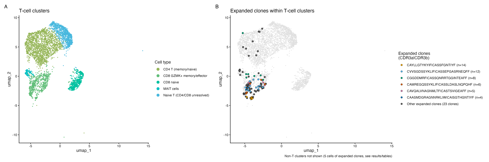

# T-cell clonal expansion in a healthy donor (10x 5' GEX + V(D)J, PBMC)

Small exploratory re-analysis of a public 10x Genomics dataset, written to practise paired
single-cell RNA + TCR analysis in R/Seurat. It is **not** a new finding: one donor, descriptive only.

## Question
In a healthy donor, which T-cell states carry expanded TCR clones (identical CDR3α + CDR3β in ≥3 cells)?
Expectation, fixed before looking at the clone counts: expansions sit in CD8 memory/effector cells, not in naive T cells.

## Data
- 10x Genomics, **"10k Human PBMCs, 5' v2.0, Chromium X (without intronic reads)"**, CC BY 4.0
  ([dataset page](https://www.10xgenomics.com/jp/datasets/10k-human-pbmcs-5-v2-0-chromium-x-without-intronic-reads-2-standard)).
- Healthy donor (PBMC from AllCells), 5' gene expression + V(D)J T from the same cells, Cell Ranger 6.1.2 (`cellranger multi`).
- Files used (not redistributed, download them into `data/`):
  `..._count_sample_feature_bc_matrix.h5` and `..._vdj_t_filtered_contig_annotations.csv`
  (exact file names in the config block of the script).

## Run
```r
source("pbmc_tcr_clonal_expansion.R")   # Seurat v5, hdf5r, dplyr, ggplot2 (+ ggrepel, patchwork, scales, installed with Seurat)
```
Outputs: `results/figures/` (PNG, 300 dpi), `results/tables/` (CSV tables, labelled Seurat object, `sessionInfo.txt`). Seed 42.

## Methods in brief
- **QC**: 500 < genes < 4000 per cell, mitochondrial reads < 15%. Thresholds were chosen from violin/scatter plots and
  by counting how many cells with a complete TCR each threshold removes (`results/tables/qc_threshold_grid.csv`, heatmap
  `results/figures/04_qc_threshold_loss_heatmap`). The upper gene cap removes no cell belonging to an expanded clone.
  9,331 → 7,350 cells.
- **Clustering**: 2,000 variable genes (TCR genes excluded so clusters are not driven by clonotype), 15 PCs (elbow),
  resolution 0.3. Resolution 0.6 is kept as a comparison (`results/tables/resolution_comparison.csv`): it splits clusters further
  without being needed for this question.
- **Labels**: manual, from canonical markers (DotPlot, FindMarkers). The cluster-to-label mapping is hard-coded and checked
  by `check_marker()`, because cluster numbers are not stable across versions/seeds. Naive T cells cannot be split into
  CD4/CD8 by RNA alone (no surface-protein data in the h5).
- **Clone**: identical CDR3α + CDR3β, only in cells with exactly one productive TRA and one TRB contig (3,481 cells after QC).
  Cells with two alpha chains or a missing chain are not assigned to a clone; cells with two TRB are probable doublets.
  **Expanded** = clone of ≥3 cells (size counted on all cells after QC).

## Results (descriptive)
- 29 expanded clones; the largest has 14 cells. 126 of 3,481 cells (3.6%) belong to an expanded clone.
- 110/534 cells (21%) in the CD8 GZMK+ memory/effector clusters belong to an expanded clone
  (104/463, 22%, if the second GZMK+ cluster is dropped), versus **0/1,153 in the naive T clusters**.
  No expanded clone has any cell in a naive cluster.
- CD4 T cluster (mixed naive/memory): 11/1,614 cells (0.7%).
- 16 cells of expanded clones sit outside these groups (monocyte, NK, non-immune or unassigned labels), most plausibly
  doublets or ambient TCR transcripts; listed in `results/tables/expanded_cells_outside_test_groups.csv`, not removed.

- Sanity check independent of the cluster labels (`results/figures/16_dotplot_expanded_vs_not`): among TCR 1+1 cells, those in
  expanded clones show higher CCL5/NKG7/GZMK/GZMH/CD8A and lower CCR7/SELL/TCF7 than non-expanded cells.

Key figures:


Zoom on the T-cell clusters only (non-T clusters hidden; the few cells of expanded clones in those clusters are in `results/tables/expanded_cells_outside_test_groups.csv`):



## Limitations
- One donor, no replicate: no inferential statistics, no claim of generality.
- The result is the expected one (memory/effector expansion): the project shows method, not discovery.
- Marker-based labels; the CD4 T cluster mixes naive and memory cells.
- Cells without a complete TCR 1+1 are not analysed; TCR capture may differ between cell states.
- The 10x page states a female donor, but Y-linked genes (e.g. RPS4Y1) are detected in most cells
  (`results/tables/sex_check.csv`). Not relevant to this question and not investigated further.

## Use of AI
The code was developed with the help of an AI assistant (Claude). I ran the analysis, chose the parameters
and can explain each step.
